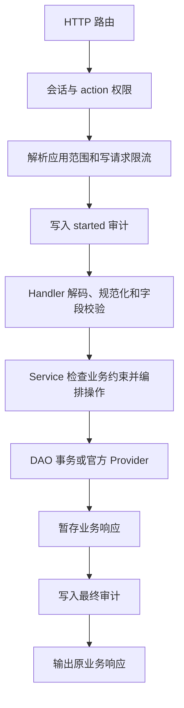

# 服务端代码结构说明

本文档描述当前服务端按领域组织的代码结构、依赖方向和多实例约束。项目尚未上线，不保留旧目录、内存运行模式、本地媒体或代理上传兼容链路。参考项目只用于理解 Styx 的能力边界，不作为本项目目录结构的复制模板。

## 从请求定位业务逻辑

先看入口方法确认“收到什么、返回什么”，再沿 Service 看业务判断，最后到 DAO 核实事务与竞争条件。`internal/service` 是 HTTP 适配层，`internal/biz/*/Service` 才是业务处理层，两者不要因目录名称而混淆。

| 场景 | HTTP 入口 | 业务逻辑 | 持久化或平台调用 |
| --- | --- | --- | --- |
| 创建管理员、分配角色 | `service/operations/rbac.go` → `rbac_validation.go` | `biz/adminrbac/administrator.go`、`role.go` | `data/persistence/mysqlstore/admin_users.go`、`admin_roles.go` |
| 登录与鉴权 | `service/operations/authentication.go`、`middleware.go` | `biz/adminrbac/authentication.go` | `mysqlstore/admin_users.go`、`admin_permissions.go` |
| 新建/编辑短剧 | `service/operations/content.go` → `content_validation.go` | `biz/operations/content.go` | `mysqlstore/catalog.go` 的聚合事务 |
| 视频直传确认 | `service/operations/media.go` → `media_validation.go` | `biz/operations/media.go`、`media_jobs.go` | `mysqlstore/drama_media_jobs.go`、`media_jobs.go` 与 BytePlus Provider |
| 发布与下架 | `service/operations/content.go` → `publication_validation.go` | `biz/operations/publication*.go` | `mysqlstore/publications.go`、`publication_write.go` 与 TikTok Provider |
| VOD 回调 | `service/operations/vod_callback.go` → `vod_validation.go` | `biz/operations/vod_events.go`、`media_jobs.go` | `mysqlstore/drama_media_jobs.go` 同步幂等唤醒任务 |
| 消费者启动 | `service/consumer/handler.go` 的 `bootstrap` | `biz/consumer_bootstrap.go` → `biz/visitor/service.go` | 应用解析器、Visitor 仓储与 TikTok 登录 Provider |
| 播放与奖励 | `service/consumer/handler.go` → `input_validation.go` | `biz/consumer/playback_service.go`、`reward_service.go` | 线上内容、应用策略、统一权益表与 VIP 进度仓储 |

表中路径均相对 `internal/`，`mysqlstore/` 是 `data/persistence/mysqlstore/` 的简写。`*_contracts.go` 逐字段描述输入与领域值，Repository 接口逐方法说明持久化合同；需要判断“是否真能原子完成”时，继续读对应 DAO 实现。

### 一次需要 action 权限的管理业务写请求的顺序



登录与退出会话使用各自入口，不经过图中的 action 权限和业务审计链。字段校验位于具体 Handler 调用业务之前；认证、应用范围解析和起始审计会更早访问自己的业务依赖。起始审计失败时业务尚未执行，可以拒绝请求。最终审计失败时业务可能已经提交，所以只记录故障并返回原结果，避免客户端误判失败后重复创建。

### 关键流程为什么这样安排

- 短剧编辑保留线上 `Published` 快照。草稿尚未重新上线时，观众继续看到之前发布成功的内容，不能直接读正在编辑的聚合。
- 上传确认先核对幂等键与回执，再让 Worker 查询 VOD、绑定分集。浏览器上报 `VID` 不等于服务器已确认资源有效；绑定使用旧 VID 作为并发条件，失败后安排远端清理。
- 发布任务冻结内容与拥有方平台身份。Worker 接管时沿用同一快照；外部写结果未知时不能盲目重放创建或送审请求。
- 回调先验签再解析，核对上传任务、空间和 VID 后同步唤醒任务，提交成功后应答。回调不直接改分集状态，重复和乱序不会回退状态；Worker 查询 VOD 兜底，不保存独立事件记录。
- 奖励请求先做字段校验；业务结算先恢复已有 claimId，已有奖励跳过新领取的 Offer 校验和权益写入；VIP 奖励响应仍要查询当前进度，相关依赖失败时仍会返回错误。
- Service 收到依赖错误时记录具体操作和实际错误，HTTP 再映射对外错误。日志中的数据库原因与客户端错误码用途不同；DAO 允许仅返回错误。

## 目录与依赖方向

| 目录 | 职责 | 允许依赖 |
| --- | --- | --- |
| `internal/biz` | 聚合、值对象、仓储端口、业务用例、跨聚合流程和 Worker 业务生命周期 | 标准库、`internal/conf`、`internal/pkg`、显式的业务子包 |
| `internal/pkg` | 业务无关的项目级薄适配层；`apierr` 集中注册状态码、稳定错误码和消息键，固定英语错误文案桥接 Styx 消息接口 | 标准库、Styx |
| `internal/data` | MySQL、TikTok OAuth、TikTok Media Asset API、BytePlus VOD 等出站适配器 | `internal/biz`、`internal/conf`、Styx 基础设施工厂、GORM |
| `internal/service` | HTTP 解码、认证上下文、权限调用、错误映射和响应编码 | `internal/biz`、`internal/conf`、`internal/pkg` |
| `internal/server` | 把 HTTP Handler 和 Worker 接到 Styx/Kratos 生命周期 | `internal/biz`、`internal/service`、`internal/conf`、Styx |
| `cmd/server` | 配置加载和唯一 Wire 组合根 | `internal/{biz,data,service,server}` 与 Styx |
| `internal/testsupport` | 自动化测试使用的内存实现和固定数据 | 仅 `_test.go` 可依赖 |

依赖必须由外向内：`server → service → biz`，`data → biz`。`data` 实现 `biz` 声明的端口，由 Wire 注入；`biz` 不得反向引用 MySQL、GORM、Styx、Kratos 或 HTTP 实现。消费者启动这类跨聚合流程属于 `biz`，HTTP Service 只能调用已注入的用例，不能自行创建。各层的 `ProviderSet` 只声明构造函数集合，最终组合只发生在 `cmd/server/wire.go`。`internal/architecture_test.go` 会扫描生产文件的 import 并阻止反向依赖，也会阻止生产代码依赖 `internal/testsupport`，并审计新增的进程内同步状态。

## 领域边界

- `biz/consumer`：短剧目录、播放许可和消费者查询流程；通过窄端口调用变现领域，不拥有应用、投放或变现配置模型。
- `biz/visitor`：TikTok 静默登录、内部 Visitor 映射和自包含 VisitorToken。匿名启动仅用于本地开发与测试。内部主体与 TikTok 身份使用同一张 `users` 表，按应用与 OpenID 摘要唯一识别；不保存平台令牌，不实现匿名转正式的权益迁移。
- `biz/application`：TikTok 应用聚合、应用上下文和广告位编码集合。广告位只是应用记录的一组编码，不是独立实体、数据表或 CRUD 资源；`biz/application_resolver.go` 按请求实时解析，不在进程内缓存运营配置或身份 Provider。
- `biz/monetization`：消费设置、逐集与 VIP Offer、奖励结算事实、权益和 VIP 进度。
- `biz/campaign`：TikTok 投放落地配置及服务端校验后的请求级归因上下文。
- `biz/adminrbac`：管理员、JWT 认证与账号版本撤销、角色和可自定义权限树分配。基础请求限流由 HTTP 边界调用进程内限流器，不把频次状态混入认证领域。
- `biz/mediaconfig`：校验 MySQL 持久化并由 Redis 缓存的 BytePlus VOD 与回调验签参数；每次操作读取当前配置，SDK 客户端按配置变化重建。

运营管理用例位于 `biz/operations`。该包本身是“运营后台”边界上下文，内部继续按业务能力拆分，而不是把所有类型放进 `model.go`、把所有用例放进 `service.go`：

- `applications.go` / `application_contracts.go`：应用档案及其输入、端口；
- `campaigns.go`：编排 `biz/campaign` 的投放活动和落地链接；
- `content.go` / `content_contracts.go`：短剧聚合、剧集、发布与运营概览；
- `publication*.go` / `official_media_contracts.go`：冻结送审快照，编排视频登记、转码、审核、上线与逐应用授权；
- `campaign_targets.go`：仅向投放角色提供当前应用可使用的线上短剧与分集，不暴露草稿或 VID；
- `media.go` / `media_jobs.go` / `media_contracts.go`：VOD 直传、持久化任务和多实例 Worker；
- `reporting.go` / `reporting_contracts.go`：消费者聚合指标与管理员审计；
- `monetization.go`：编排 `biz/monetization` 的应用消费设置；`tiktok_tags.go` 维护公共 TikTok 标签目录；
- `service.go`：只保存用例门面依赖和构造函数，不承载具体业务方法；
- `repositories.go`：只组合各领域的窄端口。

仓储先按最小用例声明，再装配到六个显式边界：

- `ApplicationPorts`：应用档案，包括随应用整体保存的广告位编码集合；
- `MonetizationPorts`：应用消费设置；
- `CampaignPorts`：投放活动和落地链接；
- `ContentPorts`：所有应用共享的短剧目录和 TikTok 标签；
- `MediaPorts`：多实例媒资任务和远端清理队列；
- `ReportingPorts`：运营统计和管理员审计。

`Repositories` 只保存这六组窄端口，不提供全局 `valid()` 或包含所有能力的 `Persistence`。每个业务方法只校验自己使用的端口，因此应用查询不会被媒资或审计实现绑定。当前 MySQL Store 可以在 `data` 组合根同时实现多个端口，但该具体类型不跨层暴露。

`biz/adminrbac` 同样按管理员、认证会话、角色和权限拆分用例与端口；`data/persistence/mysqlstore/admin_*.go` 与之同构。`service/operations` 的路由注册和 Handler 也按认证、应用、投放、内容、媒资、报表和 RBAC 拆分，`handler.go` 只做组合。这样修改一个能力时，可以从 HTTP 合同、业务端口到 GORM 实现沿同一领域纵向定位，不需要在三个万能大文件中跳转。

## 多实例数据模型

所有服务实例必须连接同一套 MySQL：

- 启动配置缺少 `data.mysql.master` 时直接失败，不回退到进程内仓储。
- 消费者用户、管理员认证版本、应用配置、奖励结算、权益、运营配置和后台任务均以 MySQL 为权威；VisitorToken 与管理员 JWT 自包含且不落库。
- 消费者启动及公开目录请求必须显式携带官方 `tiktokAppId`；应用解析器每次按该标识精确查询共享仓储，因此任一实例上的禁用或配置更新会被其他实例观察到。
- 应用名称、Logo、TikTok 标识、Client Key、仅服务端使用的 Client Secret 和历史 `secretRef` 只属于 `applications` 聚合；进程配置不创建默认应用，也不为请求补充默认应用编码。
- CORS 来源白名单与预检响应属于入口网关或同源部署边界，消费者和运营业务 Handler 不设置 CORS 响应头。
- 最终 Schema 为新库写入默认目录、页面和操作权限树；权限节点、角色及分配关系以 MySQL RBAC 表为权威，运营可维护名称、编码、层级、站内路径、导航图标、排序和启停状态。接口只按操作节点编码鉴权，页面和目录不授予接口能力，父节点停用使子树失效。首个超级管理员由部署 SQL 写入；仓库没有管理员初始化命令，HTTP/Worker 服务启动也不修改 RBAC 数据。
- Visitor Service 必须显式注入共享 Store；构造时缺少 Store 会返回错误。
- 媒体任务使用所有者和过期时间租约，避免多个 Worker 重复完成同一任务。
- 媒资接入参数随部署配置发布；启动时一次校验并直接构造 BytePlus Provider，不维护逐请求动态配置解析器。变更配置后必须重启实例。本地未配置媒资时使用明确的未启用适配器；预发和生产配置门禁保留。公开 Player 配置是固定 DTO，不由外部 Provider 获取。应用变现规则继续使用数据库修订号做乐观并发控制，旧修订写入返回冲突，不能被另一实例静默覆盖。

新用户 UID 由 MySQL 永久预留号段、Redis 共享当前段与备用段，通过 Lua 原子消费和切换；应用重启复用共享进度，消耗到 80% 时异步预取。Redis 故障时拒绝新用户发号，已有用户登录无需发号。存储边界与恢复要求见 [UID 分配与恢复](uid-allocation.md)。

`internal/pkg/ratelimit` 的有界进程内固定窗口计数不依赖 Redis，只用于基础请求防护：

- 仅管理员登录和已认证的普通管理端写操作使用固定窗口计数，并在 Key 中只保存限流主体的 SHA-256 摘要；分集媒资预留、续传、提交和重试不占用普通写操作配额，批量上传仍需经过会话、权限、参数、业务状态和审计校验；消费者启动不执行 IP 或安装标识限流。
- 计数器使用互斥保护、到期清理和容量上限；满容量时拒绝新主体，不无限增长。
- 计数随进程重启清空，不在多个副本之间共享。需要严格全局配额时由入口网关补充；本次没有配置实际生产网关。
- 消费者用户、RBAC、权益、奖励结算、媒资任务和发布状态仍只以 MySQL 为准。

`internal/testsupport/memory` 只用于单元测试，不能进入 Wire 图或生产构造函数。

## 媒体链路

剧集视频只使用 BytePlus VOD 官方 Web Upload SDK 直传：

1. 管理端向 API 请求限定 Space 和有效期的上传凭据。
2. 浏览器通过 `@byteplus/uploader` 直接把视频上传到 BytePlus VOD。
3. 管理端把 VOD `VID`、文件信息和幂等键提交给 API。
4. API 把确认任务写入 MySQL；任意 Worker 通过租约领取，并查询 VOD 处理结果。
5. 产物就绪后，Worker 以原 `VID` 为并发条件更新剧集；冲突或失败的远端媒资进入共享清理队列。

API 不接收视频二进制、不写实例本地暂存目录，也不暴露 `/media/`。Worker 通过 MySQL 租约竞争任务，而不是通过进程角色分流。源视频就绪由 BytePlus `GetMediaInfos` 核对 VID、Space、源文件和时长，不要求服务端取得 HLS 地址。

媒体清理先核对草稿和保留版本引用。仍有引用时保持正常等待，三十分钟后复查；远端已接受删除但尚未确认不存在时一分钟后复查。两者复用 `processing`、`next_attempt_at` 与租约，清空错误并记录带任务 ID 和原因的 INFO 日志；真实查询、删除或落库故障仍走原有失败处理。只有远端确认不存在才完成清理，不新增状态字段。

字幕生成、管理、平台登记及播放控件已移除，原始音频语言元数据仍用于官方发布。

发布时冻结内容、拥有方 Client Key/BytePlus 账号/Space/Region；所有视频先登记并查询，再调用官方批量转码并逐 VID 核验。拥有方上线立即安装独立的 `Published` 快照，额外授权逐应用写入；消费者只读取当前应用拥有或已授权的快照。编辑草稿、审核拒绝或其他应用授权失败均不覆盖线上版本。旧版分集和媒资引用在版本替换或下架前保留。

创建 Album、更新版本和提交审核前保存外部写检查点。响应丢失或进程中断导致结果未知时停止自动重放，进入 `external_write_uncertain`；当前不提供自动对账修复工具。状态写回使用租约和修订号比较并交换，过期 Worker 不能覆盖新结果。

播放授权仅查询统一权益表，不锁用户行或补发 VIP；补发在启动加载与 VIP 进度刷新中执行。消费者通过权益校验后只获得 TikTok 官方 Player 所需 Album/Episode/VID 和展示信息，不包含播放 Token、视频 URL 或取证会话；播放授权不依赖逐次播放账本写入。观看进度、收藏和历史只在客户端本地按应用与 Visitor 保存，不建设服务端接口或数据表。

## 进程入口与 Styx

`cmd/server/main.go` 只加载 `configs/config.yaml` 并调用 Styx。Styx 负责 Runtime、Logger、OpenTelemetry、Kratos App、HTTP Server 治理和关闭顺序。`cmd/server/wire.go` 是唯一组合根；`biz`、`data`、`service`、`server` 只公开各自的 `ProviderSet`。每个实例统一启动 HTTP 与后台任务，不再按进程类型维护多套依赖图。

消费者与运营接口使用 `internal/pkg/apimessages` 的固定英语错误消息，稳定错误码不变。HTTP 层继续复用 Styx 消息过滤器，业务层不再协商语言。内容仅使用主字段，TikTok 标签在消费者展示时优先使用运营维护的英文名，空值回退官方名称。

消费者失败响应同时检查错误链与请求 Context：客户端取消沿用 408 / `request_cancelled`，请求超时沿用 504 / `request_timeout`，实际依赖故障才返回 503。GORM 合并回滚错误可能丢失原取消错误链，因此 HTTP 边界需要以请求状态兜底；仍记录原始错误，成功结果不因随后取消而改写。

数据库建表与服务启动完全分离。部署前执行 `sql/init.sql`，运行进程不调用 `AutoMigrate`，也不维护历史迁移目录。不再保存结构版本表或执行版本校验；就绪检查验证 MySQL 连通性，部署流程负责确保表结构与当前代码一致。

## 维护规则

- 领域规则和用例编排放在 `biz`；`service` 只处理协议适配，不能自行决定权益或发布状态。
- 看似数字的 TikTok、BytePlus 和业务标识均使用字符串。
- 新增仓储能力时先放入最小用例端口，禁止把方法继续堆到跨领域万能接口。
- 新增运营能力时沿现有领域文件纵向扩展；禁止重新创建承载多领域类型的 `model.go`，也禁止把具体用例堆回 `service.go` 或 HTTP `handler.go`。
- 新增运行时状态前必须回答“另一实例如何观察和接管”；无法回答时不得使用进程内 map、文件或缓存作为权威数据。
- 修改接口同时更新 `docs/api-contract.md`、`docs/operations-api.md` 及对应客户端。

## 验证

代码修改后运行：

```bash
make verify
```

涉及 Schema 或 MySQL 仓储时，再使用隔离 MySQL 运行：

```bash
TEST_MYSQL_DSN='root:本地测试密码@tcp(127.0.0.1:33306)/?parseTime=true&loc=UTC&multiStatements=true' \
make test-integration
```

自动化测试不得调用真实 TikTok 或 BytePlus；真实登录、IAA 和官方 Player 只在 TikTok 设备预览中验收。
