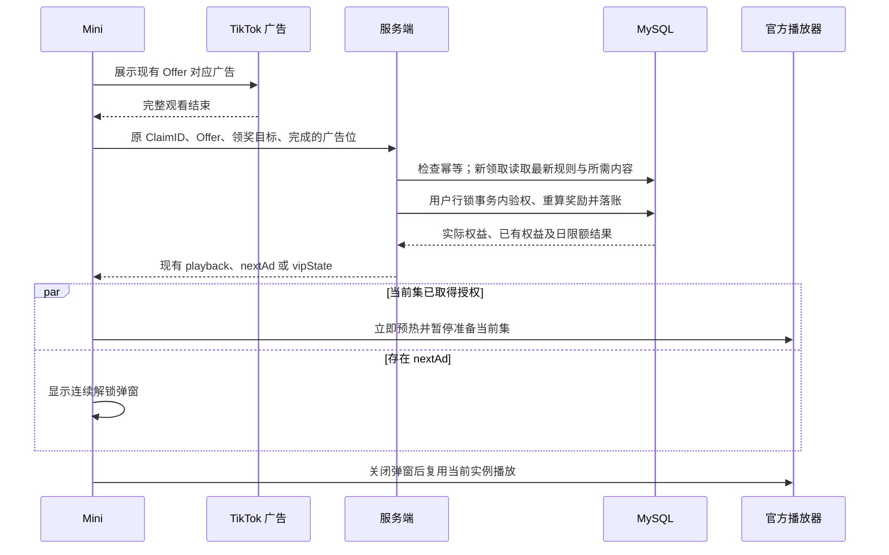

# 广告领奖与播放恢复

复用 `POST /api/v1/reward-grants` 及现有 `playback`、`nextAd`、`vipState` 字段，不增加观看上下文接口。应用变现模式固定，本流程只处理现有广告入口。

## 策略与幂等

- 新 ClaimID 读取服务端最新配置，按 Offer 中的应用与规则编码选择同一条当前规则。Offer 的旧修订号不阻止领取，也不用于恢复旧策略。
- 规则删除、停用或实际完成的广告位已不匹配时，拒绝该次新领取，不借用另一条同类型规则。
- 已成功的 ClaimID 恢复原有实际授予集合、有效期和结算目标；配置更新不能使它重复计次或扩大已发奖励。实时 `nextAd`、VIP 状态与播放授权另按当前状态生成。
- 新结算不保存策略版本快照；旧数据库列保留兼容，不作为结算依据。实际权益与奖励流水仍在 MySQL 持久化。

## 前后端交互

内容广告的单集、批量、整剧及组合权益共用这条 Mini 链路。Mini 不计算解锁数量，不扫描目录决定下一广告。领奖返回的 `playback` 属于实际领奖目标，只有与当前页面剧集匹配时才能装入播放器，后续集的领奖不能切换当前观看目标。

VIP 广告继续独立累计进度，激活后按现有流程验权当前集一次。未取得播放授权的锁定集不能预热。网络失败保留原 ClaimID 补领；广告未看完不领奖。有待领取记录时先恢复领取，不重复拉起广告。

## 按实际策略读取

首次内容领奖复用一次已发布目录读取，在准备奖励、构造播放授权和计算 `nextAd` 之间传递结果，避免再次查询同一剧。当前已发布目录仍存于整段 `published_snapshot` JSON；本次不改存储结构，不声称实现了单集 JSON 的数据库局部读取。

2026-10-24 起，为在结算回包中返回完整选集状态，逐集奖励统一批量读取本剧分集投影，并与授予构造、连续提示共用；不读取该用户其他剧的权益。目录快照仍只读取一次：

| 策略需求 | 权益检查范围 |
| --- | --- |
| 单集且无连续提示 | 本剧分集与覆盖它们的整剧、目录级权益，用于结算后的选集状态 |
| 批量解锁 | 本剧分集，锁内从候选集跳过最新已解锁集后补足 |
| 整剧或组合权益 | 覆盖完整授予范围，保留整剧及后续更新的原有语义 |
| 连续提示开启 | 当前剧完整目录所需权益，包括当前目标之前的集 |
| VIP | 当前规则进度和目录级权益，不读取剧集目录 |

奖励事务使用 MySQL 用户行 `SELECT FOR UPDATE`，保留 ClaimID 唯一性和锁内批量重算，不依赖 Redis 锁。权益查询限定已认证应用、用户分片和相关目标，不扫描该用户其他剧的权益。

## 连续提示和播放器

- `nextAd: null` 表示停止提示，包括关闭配置、入口不可用、达到限额、目录级权益生效、全剧已解锁、最早锁定集媒资未就绪或附加决策失败。跳看末集仍会检查前面的锁定集。
- 非空 `nextAd` 包含 `dramaId`、`episodeId`、`episodeNumber`、`unlockedCount`、`totalCount`、`offer`。它是后续广告决策，不是播放许可。
- 取消连续弹窗停止本轮；继续时新建 ClaimID，完整观看后再向服务端领取。倒计时使用服务端配置，旧响应缺省三秒；页面进入后台时暂停倒计时。
- 附加提示失败只记录日志并停止提示，不撤销已完成的奖励，不重复发奖。内容领奖响应缺少 `playback` 时才走兼容验权。
- 当前集授权一旦到达即可独立准备播放器。弹窗只阻止实际播放，不应清空预热或重建播放器。页面换集、身份变化及授权失效仍按原规则隔离资源。

管理端没有消费者领奖调用方，原策略编辑与组合权益配置继续适用。真实 TikTok 环境中广告退出、SDK 准备与首帧耗时需真机复测；自动化测试不能证明具体设备的延迟改善幅度。
