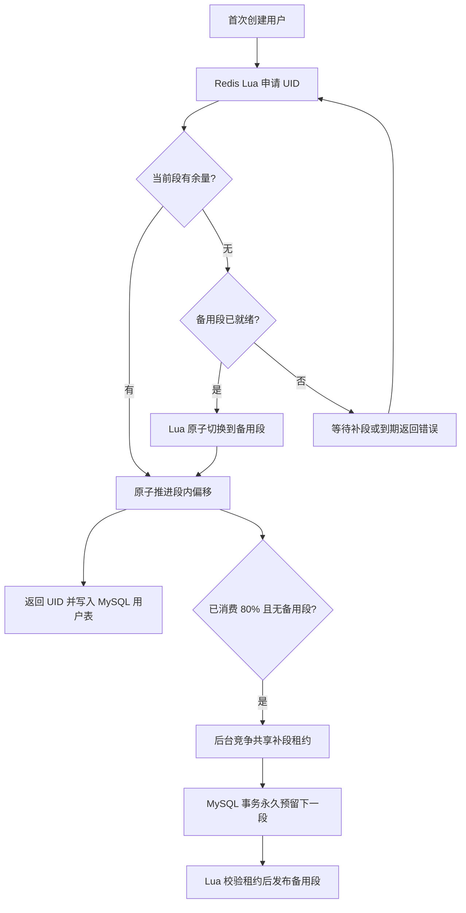

# UID 分配与恢复

消费者用户 UID 使用 MySQL 永久预留号段、Redis 共享发号进度。所有 API 实例消费同一个当前段，应用发布、扩容或重启继续原进度，避免每个进程重新预留大段 UID。现有 UID、16 张 `users_XX` 非自增主键、1024 个逻辑桶路由及 API 十进制字符串合同不变。奖励、权益与 VIP 进度的内部记录仍由各自物理表自增，不占用用户号段。

## 存储与分配

MySQL `id_allocators` 的 `consumer_domain` 行是号段权威来源：`next_id` 表示下一个尚未预留的起点，`segment_size` 默认 `100000`。预留事务锁定该行，将水位前移一个号段大小，提交后才能发布该段；所有已经预留的号段永久不可回收。应用不根据用户表最大 ID 回退水位，也不复用提交结果不明或发布失败的号段。此改造不修改表结构、初始化种子或已有库水位。

Redis 同一 Hash 保存当前段、备用段、当前消费量与补段租约状态。key 为 `drama:uid:{<digest>}`，`digest` 是 `SHA-256(database_name + "\x00" + server_uuid + "\x00" + namespace)` 的小写十六进制值；`namespace` 当前为 `consumer_domain`，两个分隔符均为单个零字节。每个实例首次需要发号时，从 MySQL 主库查询 `DATABASE()` 和 `@@server_uuid`，之后复用该隔离标识。同一业务的全部实例必须连接同一套 MySQL 主库与 Redis，连接串不参与 key，也不会输出到日志。

UID 起点以十进制字符串保存，Lua 只操作段内的小整数偏移，由 Go 组合最终 UID，避免大于 `2^53` 的 UID 被 Lua 浮点数舍入。

正常发号由一次 Lua 原子操作取得偏移，并在当前段用完时切换到已经准备的备用段。应用收到的 UID 不保证连续，注册失败、响应丢失和缓存重建都可能留下空号；这些空号不回收。并发请求的响应或用户写入顺序也不保证按 UID 递增。用户账号及业务记录只在 MySQL 保存，Redis 不承担唯一业务数据存储。

UID 命令使用独立的 Redis 连接池，安全复制 Styx 客户端的连接选项并由 Runtime 统一关闭；关闭网络自动重试，Cluster 同时关闭自动重定向重发，并启用上下文超时。网络错误使结果不确定时，直接返回失败，允许跳号，不重发旧请求或重新安装旧号段；调用方重试会使用新的请求 token。Lua 发布时还要求新段起点大于当前段起点，拒绝迟到的旧段重装。这些措施防止命令重试回退游标，不替代 Redis 状态回滚后的隔离与清理。

## 提前补段

当前段消耗到 80% 且没有备用段时，发号操作触发后台补段，不等待当前段耗尽。共享租约有效期为 15 秒，保证同一时刻只有一个有效补段持有者；后台预取使用独立的 5 秒上下文，首次加载号段还受请求取消及期限约束。持有者向 MySQL 预留新段，再通过 Lua 校验租约身份与缓存状态后发布为备用段。过期持有者不能覆盖新持有者的结果，重复发布不能重置已消费的进度。

补段失败时记录实际错误，固定退避 1 秒后允许重试，当前段尚有余量时继续发号。持有实例退出后，其他实例可在租约到期后接管；已经在 MySQL 预留、但未能发布的段允许丢弃。首次没有当前段，或者当前段已耗尽且备用段尚未就绪时，请求按 25 毫秒间隔在自身上下文期限内等待补段；取消、超时或依赖故障返回错误，不越界发号。



## 应用发布与首次切换

- 正常应用发布、重启和扩容只接入现有共享缓存，启动过程不得删除 UID key、重置游标或重新执行 SQL 种子。
- 从旧进程内号段实现切换时，保留 `id_allocators.next_id`，新实现从其后预留共享段。旧进程已经预留的段与新段不重叠；旧进程退出后剩余 UID 允许跳过，不写回共享缓存或 MySQL 水位。
- 没有 UID 缓存时，由共享租约选出一个实例向 MySQL 预留当前段，其他实例等待同一结果。每个实例不独立申请初始段。
- Redis 不可用时，新用户创建失败供调用方重试，不使用 MySQL 本地号段降级。已有用户换码登录先查询 MySQL 中的身份映射，无需申请 UID。内容缓存仍按各自规则回源。
- Redis 连接启动初始化失败时，服务仍可处理已有账号登录及其他无需发号的业务，但当前进程没有可用 Redis 客户端；Redis 恢复后需重启该进程以重新初始化。运行期间的短暂断连由客户端恢复；若断连伴随重启、切换或游标回退风险，仍必须先执行下述恢复隔离流程。
- 就绪检查仅依赖 MySQL，不能据此确认新用户发号可用；恢复时还需验证 Redis 发号链路。

## Redis 丢失与回滚恢复

Redis key 完全丢失时，从 MySQL 现有水位预留新段即可，旧当前段及备用段全部舍弃。应用实例重启不属于缓存丢失，不能为规避故障而在每次启动时清理共享缓存。

**恢复旧游标不安全。** Redis 持久化恢复、异步复制后的主从切换可能使 `used` 回退，重新发出已经消费的 UID。MySQL 只记录号段预留水位，无法判断 Redis 段内哪些 UID 已发出；本实现不对每次发号检查 `run_id`、`master_replid` 或节点角色，也不承诺自动识别这种回滚。单纯开启 AOF、副本或自动主从切换不能替代恢复隔离。

发生 Redis 重启、恢复、切换，或者不能确认 UID 缓存进度未回退时，按以下顺序恢复：

1. 先阻断会创建用户的发号流量，并停止使用旧 Redis 状态的应用实例、后台补段任务及旧主写入；确保不存在可继续发号的旧写入路径。
2. 恢复 Redis 服务，但继续阻断 UID 发号。核对目标环境和业务对应的 UID key，只删除该业务的发号 Hash，舍弃其中当前段、备用段与租约；不得清空整个 Redis DB，也不得恢复该 Hash 的旧备份。
3. 确认 MySQL 权威水位没有回退，启动接入唯一有效 Redis 写入端的实例。通过受控新用户请求验证从 MySQL 当前水位重新预留、正常发号后，再开放发号流量。
4. 保持旧 Redis 主节点与旧应用写入路径隔离，不能让旧缓存后续再次成为可写来源。若无法阻断自动切换后旧游标的发号窗口，这套部署不满足唯一性前提，不能先开放流量再异步清理。

本流程允许丢弃缓存与未使用 UID，不允许恢复较旧的 MySQL 号段水位后继续写入；MySQL 自身回滚恢复须单独核对全部已发放和预留范围。Redis 异常期间不得用分片内主键冲突重试代替全局唯一保证：不同 `users_XX` 表之间没有统一主键约束。

## 多进程真实存储验证

`TestUIDMultiProcessPersistenceIntegration` 在本机启动四个独立测试进程，每个进程使用四个 goroutine，调用生产 `ResolveTikTokIdentityRef`、MySQL 号段事务和 Redis Lua，并真实写入 `users_00` 至 `users_15`。父测试逐行核对返回 UID、身份摘要、应用与逻辑桶，再跨分片统计总行数及去重 UID 数；不会用内存发号替代 Redis。所有进程退出后再启动四个新进程，分别检查旧身份登录、新身份续号和跨段消费。

连接信息由 `TEST_MYSQL_DSN`、`TEST_REDIS_ADDR` 注入；Redis 默认使用 DB 15，也支持 `TEST_REDIS_DB`、`TEST_REDIS_USERNAME`、`TEST_REDIS_PASSWORD`。测试会创建独立的 `drama_iaa_*` 数据库，只抽取生产初始化脚本中 17 张相关表及号段种子。测试结束删除自己的数据库和专属 UID key，不修改连接配置所指业务库的用户或水位，不执行 `FLUSHDB`。数据库账号必须有创建和删除本次隔离库的权限。

```sh
GOWORK=off go test ./internal/data/persistence/mysqlstore \
  -run '^TestUIDMultiProcessPersistenceIntegration$' -count=1 -v
GOWORK=off go test -race ./internal/data/persistence/mysqlstore \
  -run '^TestUIDMultiProcessPersistenceIntegration$' -count=1 -v
```

2026-09-23 在本地 MySQL 8.4.11、Redis 7.4.11 分别完成普通运行和 `-race` 真实多进程验证，两次均通过，`make verify` 同样通过。每次使用全新隔离库，段大小为 256：

| 检查点 | MySQL 用户数 / 去重 UID 数 | MySQL `next_id` | Redis 当前段起点 / 已消费 | Redis 备用段起点 |
| --- | --- | --- | --- | --- |
| 首轮四进程完成 | 2272 / 2272 | 2561 | 2049 / 224 | 2305 |
| 四个新进程复登 32 次 | 2272 / 2272 | 2561 | 2049 / 224 | 2305 |
| 重启后新建 8 个用户 | 2280 / 2280 | 2561 | 2049 / 232 | 2305 |
| 第二轮四进程完成 | 4672 / 4672 | 4865 | 4609 / 64 | 无 |

返回 UID 连续覆盖 `1..4672`，均已逐行核对真实 MySQL 数据；备用段在第一轮当前段尚余 32 个 UID 时已经存在。此结果验证并发、共享预取和应用进程重启续号，不代表 Redis 恢复旧快照或自动故障切换已具备唯一性保证。
